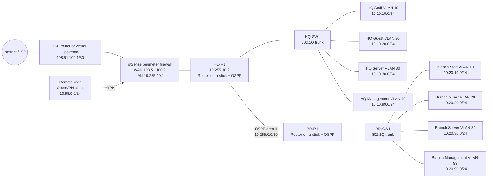

# Enterprise Network & Firewall Lab

**Two-site office network | VLANs | Inter-VLAN routing | OSPF | DHCP/DNS | ACLs | NAT | pfSense remote-access VPN**

A portfolio-ready reference implementation for designing and documenting a segmented enterprise office network across a headquarters (HQ) and a branch office. The Cisco portion is designed to be recreated in Cisco Packet Tracer. The pfSense firewall/VPN portion is configured on a separate pfSense CE/Plus virtual machine because Packet Tracer does not run pfSense itself.

> **Lab status and honesty note:** This repository contains a complete design, sample Cisco IOS configurations, pfSense configuration runbook, addressing plan, and validation checklist. It is not a prebuilt Packet Tracer `.pkt` file, and the configurations have not been applied to your equipment. Recreate the topology, test it, take screenshots, and save your own `.pkt` file before presenting the lab as personally implemented.

## 1. Project objectives

- Segment staff, guest, server, and management traffic with VLANs at two sites.
- Provide inter-VLAN routing using router-on-a-stick subinterfaces.
- Use OSPF area 0 to exchange HQ and branch routes over a point-to-point WAN link.
- Centralize DHCP and DNS services at HQ and relay DHCP requests from remote VLANs.
- Prevent guest clients from accessing RFC1918/internal networks with extended ACLs.
- Route Internet-bound traffic through a pfSense perimeter firewall and perform outbound NAT.
- Provide secure remote access to selected HQ resources using OpenVPN on pfSense.
- Apply basic Layer 2 hardening: SSH management, port security, PortFast/BPDU Guard, and unused-port shutdown.

## 2. High-level topology



The WAN-facing and internal transit ranges use documentation/private addresses for a lab. Replace them if they overlap with your home, campus, VPN, or cloud networks.

## 3. Network design at a glance

| Site | VLAN | Purpose | Subnet | Default gateway |
|---|---:|---|---|---|
| HQ | 10 | Staff | `10.10.10.0/24` | `10.10.10.1` |
| HQ | 20 | Guest Wi-Fi | `10.10.20.0/24` | `10.10.20.1` |
| HQ | 30 | Servers | `10.10.30.0/24` | `10.10.30.1` |
| HQ | 99 | Network management | `10.10.99.0/24` | `10.10.99.1` |
| Branch | 10 | Staff | `10.20.10.0/24` | `10.20.10.1` |
| Branch | 20 | Guest Wi-Fi | `10.20.20.0/24` | `10.20.20.1` |
| Branch | 30 | Servers | `10.20.30.0/24` | `10.20.30.1` |
| Branch | 99 | Network management | `10.20.99.0/24` | `10.20.99.1` |

More detail is in [`docs/ip-addressing.md`](docs/ip-addressing.md) and [`docs/addressing-table.csv`](docs/addressing-table.csv).

## 4. Components

| Component | Purpose |
|---|---|
| 2 Cisco ISR routers (e.g. 2911 in Packet Tracer) | Router-on-a-stick, OSPF, DHCP relay, guest ACLs |
| 2 Cisco access switches (e.g. 2960) | VLANs, access/trunk ports, switch management, port security |
| 4 wireless APs (2 per site) | Separate staff and guest SSIDs; each AP switch port is assigned to the matching VLAN |
| HQ DHCP/DNS server | Central DHCP pools and internal DNS records |
| HQ application server | Example internal web service for VPN-access testing |
| pfSense CE/Plus VM | Perimeter stateful firewall, outbound NAT, OpenVPN remote access |
| ISP/upstream router or virtual NAT network | Internet-side connectivity for the pfSense VM |

**Wi-Fi compatibility note:** For a straightforward Packet Tracer build, use two APs per site: one AP connected to an access port in VLAN 10 for staff, and one in VLAN 20 for guests. A generic Packet Tracer AP may not support multiple VLAN-tagged SSIDs on one uplink. If your selected AP/WLC supports VLAN-tagged SSIDs, a trunk-based design can be used instead.

## 5. Repository structure

```text
enterprise-network-firewall-lab/
├── README.md
├── LICENSE
├── CONTRIBUTING.md
├── .gitignore
├── configs/
│   ├── cisco/
│   │   ├── hq-router.cfg
│   │   ├── branch-router.cfg
│   │   ├── hq-switch.cfg
│   │   └── branch-switch.cfg
│   └── pfsense/
│       ├── firewall-rules.md
│       ├── outbound-nat.md
│       └── openvpn-remote-access.md
├── diagrams/
│   └── topology.mmd
├── docs/
│   ├── architecture.md
│   ├── ip-addressing.md
│   ├── addressing-table.csv
│   ├── packet-tracer-build-guide.md
│   ├── dhcp-dns-setup.md
│   ├── wifi-setup.md
│   ├── security-policy.md
│   ├── validation-checklist.md
│   └── troubleshooting.md
└── resume/
    ├── resume-bullets.md
    └── linkedin-description.md
```

## 6. Quick implementation sequence

1. Build the physical/logical topology in Packet Tracer using [`docs/packet-tracer-build-guide.md`](docs/packet-tracer-build-guide.md).
2. Configure VLANs and access/trunk ports using `configs/cisco/*switch.cfg`.
3. Configure router subinterfaces, DHCP relay, guest ACLs, and OSPF using `configs/cisco/*router.cfg`.
4. Add DHCP/DNS services and static server addresses using [`docs/dhcp-dns-setup.md`](docs/dhcp-dns-setup.md).
5. Configure four APs and test both SSIDs using [`docs/wifi-setup.md`](docs/wifi-setup.md).
6. Build the separate pfSense VM and configure static routing, firewall policies, outbound NAT, and OpenVPN using `configs/pfsense/`.
7. Execute every applicable test in [`docs/validation-checklist.md`](docs/validation-checklist.md). Capture evidence and save your Packet Tracer file as `packet-tracer/enterprise-network-firewall-lab.pkt`.
8. Publish the repository using [`docs/github-upload.md`](docs/github-upload.md).

## 7. Key security controls

- Guest VLAN ACLs explicitly allow DHCP and internal DNS before denying RFC1918 destinations.
- Guest clients cannot initiate traffic to staff, server, management, or other private networks.
- pfSense WAN inbound traffic is denied by default; only the OpenVPN listener is exposed for this lab.
- Outbound NAT is configured for routed internal networks behind the pfSense LAN transit interface.
- OpenVPN clients receive a dedicated `10.99.0.0/24` pool and access only the internal resources/ports explicitly permitted by the OpenVPN firewall rules.
- SSH is used for Cisco device management; Telnet is disabled in the sample configurations.
- Access switch ports use port security; unused ports are administratively shut down.

See [`docs/security-policy.md`](docs/security-policy.md) for the policy matrix and limitations.

## 8. Validation evidence to add before publishing

Add your own screenshots to an `evidence/` folder:

- VLAN table and trunk status (`show vlan brief`, `show interfaces trunk`).
- OSPF neighbors and learned routes (`show ip ospf neighbor`, `show ip route ospf`).
- DHCP lease on one staff client at each site.
- Successful staff-to-server and HQ-to-branch connectivity.
- Guest-to-internal ping/connection blocked while guest Internet access works.
- pfSense firewall rule view and outbound NAT rule.
- Successful OpenVPN connection and access to the allowed HQ test service.

Do not include passwords, private keys, VPN client profiles, public IPs, or personal data in screenshots or commits.

## 9. Resume-ready summary

Use the wording in [`resume/resume-bullets.md`](resume/resume-bullets.md) only after you have implemented and tested the relevant controls. Do not claim a feature as completed just because its configuration example is included in this repository.

## 10. Important lab boundaries

- Cisco Packet Tracer does not execute the pfSense operating system. Use Packet Tracer for Cisco routing/switching and a separate pfSense VM for firewall/VPN practice. For one integrated emulated topology, use GNS3 or EVE-NG with a legally obtained pfSense image and suitable Cisco/virtual router images.
- `198.51.100.0/24` is reserved for documentation examples, not public Internet routing. Use your lab's actual upstream network for the pfSense WAN.
- This baseline is IPv4-only. If you enable IPv6 on clients or routers, add equivalent IPv6 guest-isolation and firewall rules before treating the segmentation as secure.
- Replace all `CHANGE_ME` secrets before use. Never commit real credentials or exported OpenVPN profiles.
- Device interface names and available commands vary by model and IOS image. Confirm with `show ip interface brief` and adapt interface names before pasting.

## 11. Suggested GitHub topics

`networking` `cisco` `packet-tracer` `vlan` `ospf` `pfsense` `firewall` `vpn` `acl` `nat` `network-security` `homelab`
